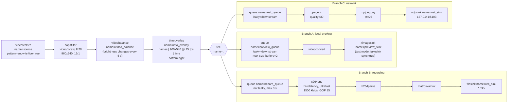

# Architecture — video monitoring sender and receiver

The sender is implemented twice with the **same pipeline**:

- `scripts/sender.sh`: a command-line version based on `gst-launch-1.0`;
- `build/monitor_sender`: the native C++ application (`src/monitor_sender.cpp`).

The graph of the real running pipeline, dumped by `monitor_sender` with
`GST_DEBUG_DUMP_DOT_DIR`, is in [`evidence/pipeline.png`](evidence/pipeline.png).

## 1. Diagram of the complete sender



The same pipeline, as text (this is the description given to
`gst_parse_launch()`; `scripts/sender.sh` uses the same one with `gst-launch-1.0`):

```
videotestsrc name=source pattern=snow is-live=true
  ! video/x-raw,format=I420,width=960,height=540,framerate=15/1
  ! videobalance name=video_balance
  ! timeoverlay name=info_overlay text="Lorenzo Bravard | 960x540 @ 15 fps |"
      halignment=right valignment=bottom shaded-background=true font-desc="Sans 14"
  ! tee name=t
  t. ! queue name=preview_queue leaky=downstream max-size-buffers=2
     ! videoconvert ! ximagesink handle-events=false name=preview_sink
  t. ! queue name=record_queue max-size-time=3000000000 max-size-buffers=0 max-size-bytes=0
     ! x264enc tune=zerolatency speed-preset=ultrafast key-int-max=15 bitrate=1500
     ! h264parse ! matroskamux ! filesink name=rec_sink location=<output>.mkv
  t. ! queue name=net_queue leaky=downstream
     ! jpegenc quality=30 ! rtpjpegpay ! udpsink name=net_sink host=127.0.0.1 port=5103
```

All values come from `config/team.conf` (pattern, size, frame rate, port,
overlay position, container). The scripts pass them to `monitor_sender` as
command-line options.

## 2. Main elements: names and purposes

| Element (name) | Purpose |
|---|---|
| `videotestsrc` (`source`) | Live source (`is-live=true`): produces frames in real time at the clock rate, like a camera. The `snow` pattern is random noise, the worst case for compression. |
| `capsfilter` | Imposes the raw format of the whole pipeline (see section 3). |
| `videobalance` (`video_balance`) | Brightness/contrast. The application changes its `brightness` every 5 s while playing (dynamic property). |
| `timeoverlay` (`info_overlay`) | Draws the team member name, the resolution and frame rate, and the running time, in the bottom-right corner. |
| `tee` (`t`) | Duplicates every frame into the three branches (it sends references, not copies). |
| `queue` ×3 | Gives each branch its own streaming thread and buffer (see section 6). |
| `videoconvert` | Converts I420 to the format the display needs (BGRx for `ximagesink`). |
| `ximagesink` (`preview_sink`) | Shows the preview in the virtual desktop. `handle-events=false` keeps it from blocking on X events under Xvfb (`autovideosink` stayed in PAUSED there). |
| `x264enc` | H.264 encoder. `tune=zerolatency` disables look-ahead and B-frames for a live source, `speed-preset=ultrafast` keeps the CPU low, `key-int-max=15` gives a keyframe every second, and `bitrate=1500` kbit/s. |
| `h264parse` | Converts the encoder output to the stream format and alignment that the muxer expects (`avc`, au) and provides the codec data. |
| `matroskamux` | Packs H.264 into a Matroska file (`CONTAINER=matroska`), with timestamps, codec data, duration and a seek index (see section 10). |
| `filesink` (`rec_sink`) | Writes the recording file. |
| `jpegenc` | Encodes each frame as an independent JPEG image. |
| `rtpjpegpay` | Splits each JPEG frame into RTP packets (RFC 2435). |
| `udpsink` (`net_sink`) | Sends the RTP packets to 127.0.0.1:5103. Its `bytes-served` property gives the number of bytes sent. |

## 3. Raw-video caps before the tee

```
video/x-raw, format=I420, width=960, height=540, framerate=15/1
```

`format=I420` (8-bit 4:2:0) is required. Without it, negotiation picks the
first format of `videotestsrc` that the whole downstream chain accepts:
`jpegenc` then receives `Y444`, and `rtpjpegpay` rejects every frame, because
RTP/JPEG only carries 4:2:0 or 4:2:2. This was measured: 90 times
`WARNING: from element rtpjpegpay0: Invalid component`, and 0 frames received.
I420 is also the native input format of `x264enc`, so no conversion is needed
in the recording branch. Fixing the caps before the tee means that the three
branches receive exactly the same frames.

## 4. Transmission: codec, RTP payload, UDP port

| | |
|---|---|
| Codec | JPEG (`jpegenc`), quality 30 by default (`--jpeg-quality`). The choice of 30 is measured in `experiment.md`. |
| RTP payload | RTP/JPEG, RFC 2435, **static payload type 26**, 90 kHz clock |
| Transport | UDP to **127.0.0.1:5103** (`PORT` in `team.conf`) |
| Receiver caps | `application/x-rtp,media=video,clock-rate=90000,encoding-name=JPEG,payload=26` |

## 5. Recording: codec and container

| | |
|---|---|
| Codec | H.264 (x264, Constrained Baseline profile, 1500 kbit/s, 1 keyframe per second) |
| Container | Matroska (`.mkv`), muxer `matroskamux` |
| Files | `artifacts/test-recording.mkv` (verification), `recordings/sample.mkv` (committed 90 s sample) |
| Playback | `scripts/play-recording.sh [file]`: `filesrc ! matroskademux ! h264parse ! avdec_h264 ! videoconvert ! ximagesink` |

H.264 is used for the file and JPEG for the network because they have
different needs. A recording should be small, and losses do not exist in a
file: 90 s take about 17 MB. A live stream on UDP must survive packet loss,
and every JPEG frame is independent.

## 6. The queues

A `tee` pushes each frame into its branches one after the other, **in the
source's streaming thread**. Without queues, the slowest branch would block
the source and therefore every other branch. With a non-live source we even
measured a complete deadlock: the first sink blocks the thread during preroll,
so the second sink never receives a frame and the pipeline never reaches
PLAYING. Each `queue` starts a new thread for its branch, so the branches run
independently.

| Queue | Settings | Why |
|---|---|---|
| `preview_queue` | `leaky=downstream`, `max-size-buffers=2` | The preview only needs the latest image. If the display is slow, old frames are dropped instead of accumulating, and the preview never holds back the recording or the network. |
| `record_queue` | **not leaky**, `max-size-time=3 s`, no buffer or byte limit | The recording must not have gaps, so no frame is dropped. The 3 s buffer absorbs short bursts of the encoder (x264 is slower on some frames) without blocking the tee. |
| `net_queue` | `leaky=downstream`, default limits | A live frame that arrives late is useless. If the network branch falls behind, frames are dropped there, and the preview and the recording are not affected. |

## 7. How the receiver reconstructs the stream

`scripts/receiver.sh display|test`:

```
udpsrc port=5103 buffer-size=<rmem_max> caps="application/x-rtp,...,encoding-name=JPEG,payload=26"
  ! rtpjitterbuffer latency=200 ! rtpjpegdepay ! jpegdec
  ! videocrop right=0 bottom=4 ! videoconvert ! ximagesink   (test mode: fakesink)
```

1. **`udpsrc`** receives the datagrams. RTP over plain UDP does not describe
   itself, so the caps are given explicitly. Without them the depayloader
   cannot be linked. `buffer-size` is set to `net.core.rmem_max`, read at run
   time: the default socket buffer is too small for snow frames, and packets
   were dropped silently by the kernel (see `debug-report.md`).
2. **`rtpjitterbuffer`** puts the packets back in order using their sequence
   numbers, and smooths the arrival times over 200 ms.
3. **`rtpjpegdepay`** gathers all the fragments of one frame, using the RTP
   timestamp, the fragment offset and the marker bit on the last packet. It
   then rebuilds a complete JPEG file, including headers and quantization
   tables, from the small RFC 2435 header. If a fragment is missing, the whole
   frame is discarded.
4. **`jpegdec`** decodes the JPEG frame into raw video.
5. **`videocrop bottom=4`**: RFC 2435 transmits the width and height in units
   of 8 pixels, so 540 becomes **544** lines after depayloading. The crop is
   computed from `team.conf` and gives back exactly 960x540. Measured: caps
   `960x544` without the crop, `960x540` with it.
6. **`videoconvert` + sink**: the frame is displayed (`ximagesink`) or counted
   (`fakesink`, test mode).

## 8. How the recording is finalized

`matroskamux` writes the video clusters as it goes. At the end it must go
back to the header to write the segment size and the duration, then append
the **Cues** index (used for seeking) and the tags. It only does this when it
receives **EOS**. `monitor_sender` therefore always stops through EOS:

1. When `--duration` expires (millisecond GLib timer), or on SIGINT/SIGTERM
   (`g_unix_signal_add`), the application sends `gst_event_new_eos()` to the
   pipeline once and prints `EOS_SENT reason=...`.
2. EOS travels from the source down all three branches. The muxer finalizes
   the file, and the sinks post EOS.
3. When every sink has received it, the bus delivers `GST_MESSAGE_EOS`. The
   application prints `EOS_RECEIVED` and leaves the main loop.
4. Only then is the pipeline set to `NULL`, which closes the file and the
   socket. The GLib sources, the bus watch, the pipeline and the main loop are
   then released, and the program exits with status 0.
5. A 5 s watchdog makes the program fail (status 1) if EOS never comes back.
   `kill -9` is never used to stop a recording.

We measured what happens without EOS: the file still decodes, but its
duration is only estimated (14.00 s instead of 15.00 s), and the Cues index
and the tags are missing. `verify.sh` checks all three: `EOS_RECEIVED` in the
log, the duration within ±0.5 s, and the Cues index at the end of the file.
The script versions get the same behaviour with `gst-launch-1.0 -e` stopped by
`timeout -s INT`.

## 9. Normal mode and test mode

| | Normal mode | Test mode |
|---|---|---|
| Sender preview (branch A) | `ximagesink` in the virtual desktop | `--headless`: `fakesink sync=true` (same timing, no window) |
| Receiver | `receiver.sh display`: `ximagesink` | `receiver.sh test`: `fakesink silent=false` + `gst-launch-1.0 -v`; one line per decoded frame is counted, the output caps are read, and it prints `RECEIVED_FRAMES` / `RECEIVED_SIZE` |
| Duration | `RUNTIME` = 90 s, or until Ctrl+C | 15 s (`verify.sh`) |
| Recording | file given with `--output` | `artifacts/test-recording.mkv`, then decoded headless by `play-recording.sh --headless` |
| Dynamic property | visible on the image (brightness) | logged: `DYNAMIC_PROPERTY element=video_balance property=brightness value=...` |
| Pipeline graph | — | DOT file dumped when PLAYING, converted to `artifacts/pipeline.png` |

Branches B and C are identical in both modes. Only the display sinks change,
so the test mode really exercises the recording and the network.

## 10. Raw and compressed video; encoder, payloader, parser, muxer

**Where the video is raw and where it is compressed** (caps read in
`evidence/pipeline.png`):

| Part | Caps | Elements |
|---|---|---|
| Sender, before the tee and branch A | `video/x-raw` (I420, then BGRx after `videoconvert`) | `videotestsrc` → capsfilter → `videobalance` → `timeoverlay` → `tee` → the 3 queues → `videoconvert` → preview sink. The inputs of `x264enc` and `jpegenc` are also raw. |
| Sender, branch B | `video/x-h264` → `video/x-matroska` | after `x264enc`: `h264parse` → `matroskamux` → `filesink` |
| Sender, branch C | `image/jpeg` → `application/x-rtp` | after `jpegenc`: `rtpjpegpay` → `udpsink` |
| Receiver | `application/x-rtp` → `image/jpeg` → `video/x-raw` | `udpsrc` → `rtpjitterbuffer` → `rtpjpegdepay` are compressed; after `jpegdec`, `videocrop` → `videoconvert` → sink are raw |

The overlay and the brightness change must be applied to raw video, before
the encoders: that is why they are placed before the tee.

**Encoder and RTP payloader do different jobs.**

- The **encoder** (`jpegenc`, `x264enc`) changes the representation of the
  image. It turns raw pixels into a compressed bitstream, with losses, and
  decides the size and the quality (for example, a 960x540 I420 frame is
  777 600 bytes raw, against about 162 KB as JPEG quality 30 on snow).
- The **payloader** (`rtpjpegpay`) does not touch the image data. It only
  prepares it for transport: it cuts each compressed frame into packets
  that fit in one UDP datagram (MTU 1400 bytes by default, so about 115
  packets per snow frame). It then adds to each packet:
  - an RTP header: sequence number, 90 kHz timestamp, payload type 26, and
    the marker bit on the last packet of the frame;
  - the RFC 2435 JPEG header: type, quality factor, width/8, height/8 and
    fragment offset. `rtpjpegpay` uses Q=255, so the quantization tables
    are also sent in the first packet of each frame. The full JPEG headers
    (markers, Huffman tables) are not sent.

**Why the receiver needs a depayloader.** UDP delivers separate packets, while
`jpegdec` expects one complete JPEG file per buffer. `rtpjpegdepay` does the
reverse of the payloader:

- it removes the RTP headers;
- it reassembles the fragments of one frame (same timestamp, offsets, marker
  bit);
- it rebuilds the JPEG headers that RFC 2435 does not transmit: markers,
  frame header with the image size, standard Huffman tables, and the
  quantization tables received in the first packet.

Without it, `application/x-rtp` cannot even be linked to `jpegdec`, which
only accepts `image/jpeg`.

**Why the receiver needs explicit caps.** `udpsrc` receives anonymous bytes.
Nothing in a UDP datagram says "RTP, JPEG, 90 kHz". The caps on `udpsrc`
give this information, so that `rtpjitterbuffer` (which needs the clock
rate) and `rtpjpegdepay` (which only accepts `encoding-name=JPEG`) can be
linked. See section 7.

**Purpose of the parser (`h264parse`).** `x264enc` outputs an H.264 byte
stream. `h264parse` cuts it into complete access units (one frame per
buffer) and converts it to the `avc` format that `matroskamux` expects. It
also extracts the SPS/PPS parameter sets as `codec_data`, which the muxer
stores in the file header so that a decoder can start.

**Purpose of the recording muxer (`matroskamux`).** An H.264 stream alone is a
plain sequence of frames, with no container: no timestamps per frame, no
total duration, no index, and no room for other tracks. The muxer wraps it in
a Matroska file:

- a header with the track description and the codec data;
- clusters of frames with their timestamps;
- at EOS, the duration and the Cues index used for seeking (section 8).

This is what makes the file playable and seekable by any player
(`gst-discoverer-1.0` reports "container: Matroska, video: H.264").

## Construction choice: option B, `gst_parse_launch()`

`monitor_sender` builds the pipeline from a text description with
`gst_parse_launch()`. The elements it must control at run time are retrieved
by name with `gst_bin_get_by_name()`: `video_balance` for the dynamic
brightness, and `net_sink` for the byte counter.

- **Advantage**: the pipeline is readable in one block, and it is the same
  description as `scripts/sender.sh`. It was validated first with
  `gst-launch-1.0`, then ported without rewriting by hand 17 elements, their
  properties, the request pads of the `tee` and the links. Option A would
  need one `gst_element_factory_make()` plus `g_object_set()` per element,
  plus the explicit links and request pads, each with its own error checking.
- **Limitation**: mistakes in the description are only detected **at run
  time**, not at compile time. A misspelled property or a missing plugin
  appears as a `gst_parse_launch()` error when the program starts, which is why
  `verify.sh` checks the elements first with `gst-inspect-1.0`. The text also
  needs careful quoting: the overlay text contains spaces and `|`, and the
  output path is inserted into the string. Option A would also allow finer
  control: linking pads one by one, or adding and removing a branch while
  running.
